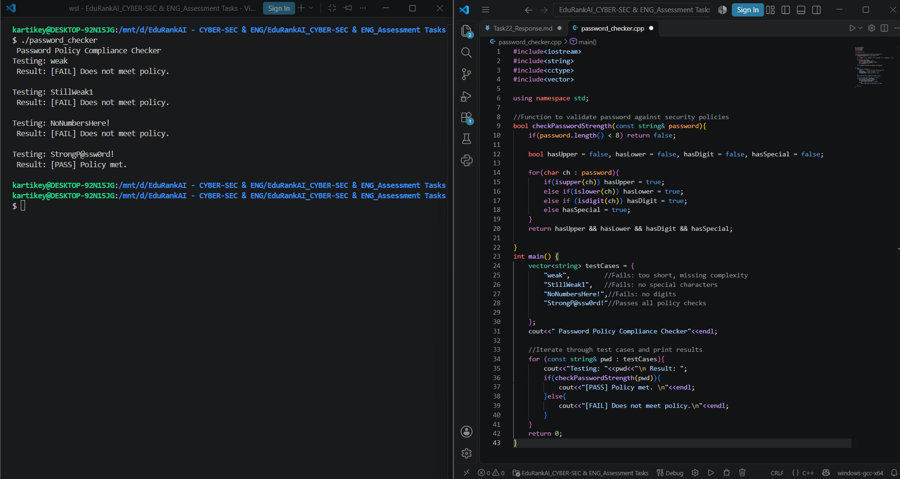

# Task 13: Build a Small Defensive Security Tool

**Tool:** Password Policy Compliance Checker
**Language:** C++

## Problem Statement
The objective of this task is to create a simple defensive tool for a benign task. This C++ script validates passwords against standard security policies, ensuring they meet minimum length requirements and contain a mix of uppercase, lowercase, numbers, and special characters.

## Test Cases
The tool runs through four synthetic test cases to verify the logic:
1. `weak` (Fails: too short, missing complexity)
2. `StillWeak1` (Fails: missing special character)
3. `NoNumbersHere!` (Fails: missing digit)
4. `StrongP@ssw0rd!` (Passes all policy checks)

## Compilation and Execution
To compile and run this tool in a Linux/Ubuntu terminal using `g++`:

```bash
g++ password_checker.cpp -o password_checker
./password_checker
```

## Sample Output
```text
--- Password Policy Compliance Checker ---
Testing: weak
Result: [FAIL] Does not meet policy.

Testing: StillWeak1
Result: [FAIL] Does not meet policy.

Testing: NoNumbersHere!
Result: [FAIL] Does not meet policy.

Testing: StrongP@ssw0rd!
Result: [PASS] Policy met.
```

## Execution Evidence
A screenshot of the successful terminal compilation and execution is included in this repository.
